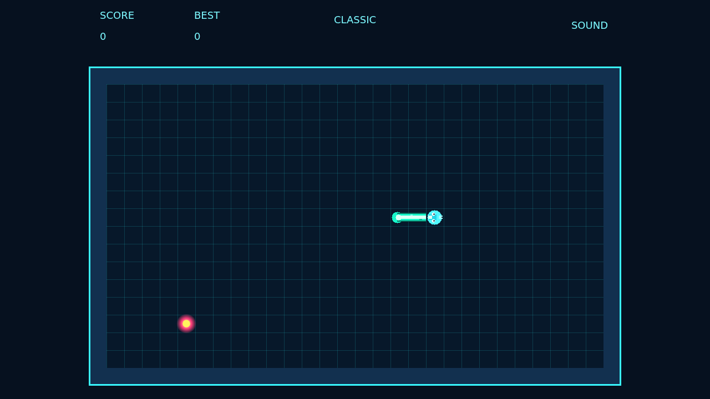
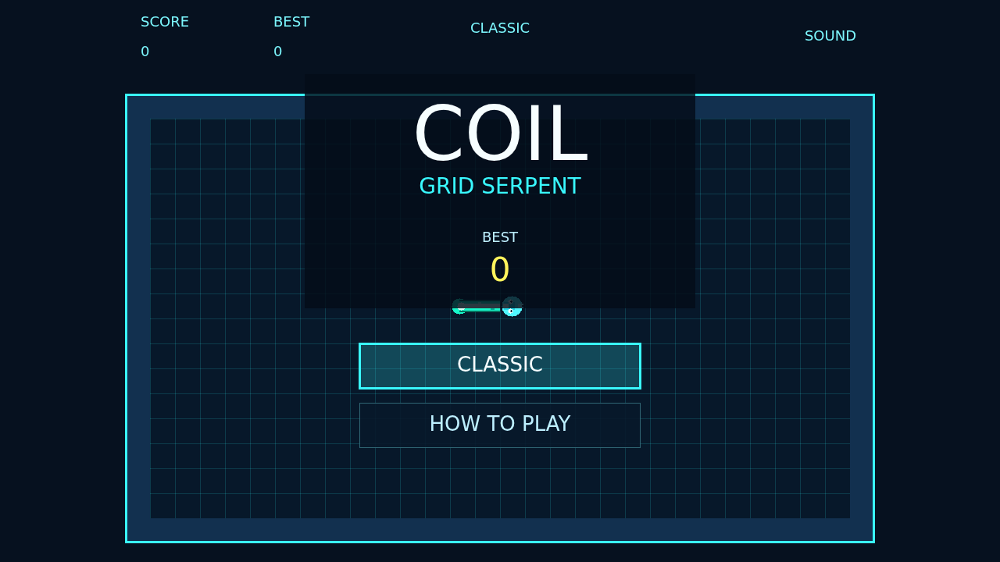

Coil is a neon grid serpent about threading a clean path through a bordered board. The snake never stops moving, and each turn you queue lands on the next tick, so every corner is a small commitment.

Pellets make the serpent longer and push your score upward. The wall border and your own body are fatal, but the tail keeps moving, so close routes can be safe when you read the rhythm correctly.

The pressure comes from the combo window. Eat pellets quickly and the multiplier climbs, but wait too long and it drops back to one. Strong runs are not only about surviving; they are about seeing the next route before the current one closes.

